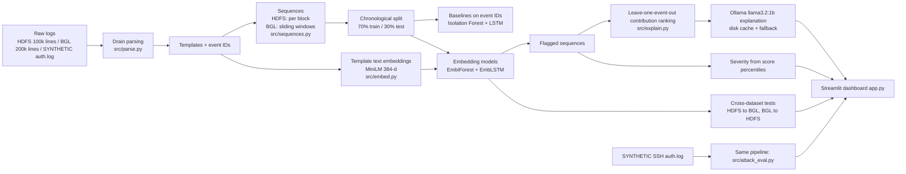

# LLM-Assisted Explainable Log Anomaly Detection for Security Monitoring
*with cross-dataset evaluation and a synthetic attack-simulation test*

A college mini project (proof of concept, CPU only, built within ~3 hours).
Raw logs -> Drain templates -> event sequences -> anomaly models (Isolation Forest, DeepLog-style LSTM) ->
explanations (event-contribution ranking + local LLM) -> Streamlit dashboard.

> **Read the Limitations section.** The datasets are small samples and several results are weak or noisy.
> This README reports what the code actually produced, including the bad numbers.

## Architecture



## Setup (Windows, PowerShell)

```powershell
python -m venv venv
.\venv\Scripts\Activate.ps1
pip install -r requirements.txt          # pinned versions that were actually used
ollama pull llama3.2:1b                  # for LLM explanations (Ollama must be running)
```
Notes: `all-MiniLM-L6-v2` (~90 MB) downloads automatically the first time embeddings are computed
(code falls back to TF-IDF only if that fails; it did not fail here).
Data needed (gitignored): from `references/` (clone of loghub + loglizer) copy `loglizer/data/HDFS/HDFS_100k.log_structured.csv` and
`loglizer/data/HDFS/anomaly_label.csv` into `data/raw/` (see `config.yaml`; the label file is saved there as `HDFS_anomaly_label.csv`).
For BGL run `python src/get_bgl.py` (small partial download, about 15 MB, creates `data/raw/BGL_200k.log`).

## How to run each step

| Step | Command | Output |
|---|---|---|
| A. (BGL data) + parse + sequences | `python src/get_bgl.py`, then `python src/parse.py` then `python src/sequences.py` then `python src/sequences.py` | `data/parsed/`, `data/sequences/` |
| B. baselines | `python src/evaluate.py` | `results/metrics.csv`, `confusion_baselines.png` |
| C. cross-dataset | `python src/evaluate.py cross` | `results/cross_dataset.csv/.png`, threshold sensitivity CSV |
| D. save models + dashboard | `python src/pipeline.py` then `streamlit run app.py` | `data/models/*.pkl`, dashboard on localhost:8501 |
| E. synthetic attack test | `python src/attack_eval.py` | `data/synthetic/SYNTHETIC_auth.log`, `results/attack_*` |
| F. collect tables | `python src/make_report.py` | `results/results_tables.md` |

All paths and hyperparameters are in `config.yaml`; seeds are fixed (42).

## Data actually used

| Dataset | Subset | Sequences | Train (normal/anomalous) | Test (normal/anomalous) |
|---|---|---|---|---|
| HDFS | first 104,815 lines (loglizer sample), 25 templates | 7,940 blocks | 5,366 / 192 | 2,261 / 121 |
| BGL | first 200,000 lines of the full BGL log (about 6 days, 2005-06-03 to 06-09), 132 templates | 19,999 windows (size 20, step 10) | 12,962 / 1,037 | 5,962 / 38 |

Split is chronological (first 70% train, last 30% test). Anomaly models train on **normal** training sequences only.
HDFS labels are per block; a BGL window is anomalous if any line in it is.
BGL's alerts are concentrated early, so train is 7.4% anomalous but test only 0.6% (38 windows): a harsh, realistic base-rate shift.
The BGL slice is fetched by `python src/get_bgl.py` (a partial HTTP download of about the first 15 MB of the 57 MB archive; the full dataset is not downloaded).
An earlier version of this project used the 2,000-line `BGL_2k.log` sample (60 test windows); its numbers were too noisy and are replaced by the ones below.

## Results

Full tables: `results/results_tables.md` (generated from the CSVs). Key results:

### In-dataset baselines, event-ID features
| Dataset | Model | Precision | Recall | F1 | ROC-AUC | PR-AUC |
|---|---|---|---|---|---|---|
| HDFS | Isolation Forest | 0.196 | 0.182 | 0.189 | 0.568 | 0.074 |
| HDFS | LSTM (DeepLog) | 0.933 | 0.463 | 0.619 | 0.660 | 0.491 |
| BGL | Isolation Forest | 0.028 | 1.000 | 0.055 | 0.865 | 0.024 |
| BGL | LSTM (DeepLog) | 0.064 | 1.000 | 0.119 | 0.943 | 0.056 |

On BGL, recall is 1.0 but precision is very low (1,300 and 560 false alarms among 5,962 normal test windows). Test prevalence is only 0.6%
(PR-AUC of random guessing = 0.006), so PR-AUC of 0.024 / 0.056 is roughly 4-9x better than chance but still poor in absolute terms.
The ranking (ROC-AUC 0.87 / 0.94) is good; the fixed thresholds are the problem, because they were set when the anomaly rate was much higher
(7.4% in train).

### Embedding models, in-dataset and cross-dataset (F1 / ROC-AUC)
| Model | HDFS->HDFS | BGL->BGL | HDFS->BGL | BGL->HDFS |
|---|---|---|---|---|
| EmbIForest | 0.000 / 0.795 | 0.053 / 0.904 | 0.059 / 0.882 | 0.278 / 0.366 |
| EmbLSTM | 0.586 / 0.659 | 0.090 / 0.944 | 0.143 / 0.441 | 0.228 / 0.595 |


**Threshold calibration.** The threshold for the target dataset is the 95th percentile of the source model's scores on the
target's *normal training* sequences (no anomaly labels). `results/cross_dataset_threshold_sensitivity.csv` shows F1 at the 80/90/95/99th
percentile; F1 changes a lot (e.g. HDFS->HDFS EmbIForest: 0.37 at the 90th percentile, 0.00 at the 95th), so single F1 numbers are fragile. ROC-AUC is threshold-free.

**Honest analysis.**
* **F1 is poor for every BGL experiment (0.05-0.14)** because only 0.6% of BGL test windows are anomalous: even with decent ranking, a threshold that catches most anomalies flags hundreds of normal windows. ROC-AUC is the more informative number here.
* **Ranking within BGL is good** (ROC-AUC 0.90 EmbIForest, 0.94 EmbLSTM, trained and tested on BGL).
* **Cross-dataset results are mixed and direction-dependent.** HDFS->BGL with EmbIForest still ranks well (AUC 0.88) but with F1 0.059; HDFS->BGL with EmbLSTM fails (AUC 0.44, below chance). BGL->HDFS is weak for both (AUC 0.37 and 0.60).
  The BGL anomalies may mostly be rare, unusual alert messages that any "unfamiliar template" detector ranks high; I did not test this explanation, so treat it as a hypothesis.
* **Likely reasons transfer is hard:** (1) different vocabularies (HDFS = block replication, BGL = kernel/hardware errors; nearest-template cosine similarity was only 0.30-0.43 in an early check on the small sample);
  (2) different anomaly definitions (workflow deviation per block vs. any alert line in a window); (3) different log styles (short regular sequences vs. 20 mixed lines).
* 38 anomalous BGL test windows is still a small number, and results come from one seed.
* Embeddings did not improve in-dataset results on HDFS (EmbLSTM F1 0.586 vs. ID-based LSTM 0.619).
I make no claim that the embedding approach solves cross-dataset detection.

### Synthetic SSH brute-force test (**SYNTHETIC DATA, not a real attack**)
The log `data/synthetic/SYNTHETIC_auth.log` is generated by `src/attack_eval.py` (3,132 lines; 185 injected failed-password lines:
a 160-line fast burst and a 25-line slow drip; attacker IPs are RFC 5737 documentation addresses).
Test portion: 93 windows, 35 contain an injected attack, 58 are normal.

| Model | Attack windows flagged (of 35) | Fast burst | Slow drip | False alarms (of 58) | ROC-AUC |
|---|---|---|---|---|---|
| EmbLSTM trained on SSH-normal | 17 | 17/18 | 0/17 | 0 | 0.755 |
| EmbIForest trained on SSH-normal | 28 | 17/18 | 11/17 | 9 | 0.898 |
| EmbLSTM trained on HDFS | 0 | 0/18 | 0/17 | 1 | 0.340 |
| EmbIForest trained on HDFS | 7 | 1/18 | 6/17 | 0 | 0.800 |
| EmbIForest trained on BGL | 18 | 15/18 | 3/17 | 7 | 0.841 |
| EmbLSTM trained on BGL | 0 | 0/18 | 0/17 | 0 | 0.203 |

**A caught artifact.** When BGL was still the 2,000-line sample, the BGL-trained EmbLSTM scored a "perfect" 35/35 with AUC 1.000. I checked it:
its predicted embeddings were almost identical for all inputs (mean pairwise cosine 0.98) and almost orthogonal to the true next event (0.08), so its score was just
distance to a near-constant vector, not detection. After retraining on 200k BGL lines that result disappeared (0/35, AUC 0.20), which supports that conclusion.
Models trained on HDFS or BGL are essentially unrelated to SSH logs; their scores here should not be read as detection ability.
What the test supports: the pipeline runs end-to-end on a different log type, and models trained on that log's own normal traffic catch the fast burst.
Neither SSH-trained model reliably catches the slow drip. Single seed, tiny test set, synthetic data with only 10 templates: optimistic and not generalisable.


> **Future work: real attack simulation.** Tools such as `hydra` must only be run against **your own isolated VMs** that you own and control,
> never against other people's systems or networks. I did not do this; the attack data in this project is entirely synthetic.

## Explainability and dashboard
* **Event-contribution ranking** (`src/explain.py`): remove each event from a flagged sequence, re-score, rank events by score drop.
  Works well when one event dominates (e.g. a Java `IOException` line in an HDFS block: drop 0.66 vs. about 0.02 for the others);
  it can miss anomalies caused by *missing* events.
* **LLM explanation:** `llama3.2:1b` via Ollama gets only the top contributing lines plus a short prompt. Log text is fenced in `<logs>` tags and the model
  is told to ignore instructions inside it (a mitigation, not a guarantee). Responses are cached in `.ollama_cache/`; if Ollama is down a fallback message is shown.
  A 1B model's explanations are often vague or partly wrong; treat them as a readability aid and verify against the log lines.
* **Severity:** percentile of a flagged score among all flagged scores (top 10% high, next 40% medium, rest low). It is relative, not an absolute risk level.
* **Dashboard** (`streamlit run app.py`): explorer (dataset/model/threshold slider, flagged table, detail view), model comparison page, and log-file upload.
  Tested headlessly (page rendering, no exceptions); the upload page's file-upload widget was not exercised in a browser.

## Limitations
* **Subsets only:** HDFS = first ~105k lines (about 13 minutes of logs); BGL = first 200k lines (about 6 days). Metrics are not comparable to published full-dataset numbers.
* **BGL test set is very imbalanced** (38 anomalous of 6,000 windows) because its alerts cluster early in the timeline; the train/test base rates differ (7.4% vs. 0.6%), which hurts fixed thresholds.
* **CPU only, tiny models** (LSTM hidden 64, 1 layer, 3 epochs, capped training data); longer training might help.
* HDFS blocks still open when the sample was cut may be truncated.
* Count-vector Isolation Forest cannot see most HDFS anomalies here (over 75% of anomalous test blocks have the same count vector as normal ones).
* Thresholds are a weak point (see sensitivity table). One IForest threshold (event-ID version) was chosen by best F1 on labelled *train* data.
* Single random seed; no confidence intervals. Synthetic SSH data is easy compared with real attacks.
* Proof of concept; not a production security tool. No Transformer model was built (skipped by plan).
* `shap` is installed but unused: explanations use leave-one-event-out instead, so it is not in `requirements.txt`.

## Ideas from papers and repos, and what I changed
All code is my own and was written without copying from the reference repos (I did not read their code; I only used their data files).
* **Drain** (He et al., ICWS 2017) via the `drain3` library: template mining. I added masking rules for block IDs, IPs, hex and numbers.
* **DeepLog** (Du et al., CCS 2017): next-event prediction with top-k rule. My version adds left-padding for short sequences, an "unseen event is always a miss" rule, and a score (number of misses plus a small surprise tiebreaker) so ROC-AUC can be computed.
* **Isolation Forest** (Liu et al., 2008) on event-count vectors, the usual loglizer-style baseline. I added a count of events unseen in training.
* **Loghub / loglizer** (He et al.): source of the HDFS sample with block labels and of the BGL 2k sample. Only the *data* was used.
* **Template embeddings** (sentence-embedding idea, as in semantic log-anomaly work): MiniLM (Reimers & Gurevych, Sentence-BERT) vectors replace event IDs. My EmbLSTM predicts the next event's *embedding* (cosine loss), not an event ID, so one model can score another dataset.
* Own additions: chronological splits everywhere, target-normal threshold calibration with a sensitivity table, leave-one-event-out explanation, Ollama caching and prompt-injection guard, synthetic SSH generator with labelled injected attacks and a train-contamination assertion.

## Viva preparation
See [VIVA.md](VIVA.md) (10 likely questions with short answers based on this code).
