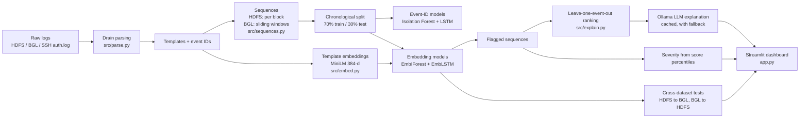

# Explainable Log Anomaly Detection for Security Monitoring

An end-to-end pipeline that turns raw system logs into ranked, human-readable security alerts. It parses logs into templates, builds event sequences, scores them with classical and deep-learning anomaly detectors, and explains every alert with event-level attribution and a local LLM, all behind an interactive Streamlit dashboard.

## Highlights

- **Template mining** with Drain: unstructured logs become structured event sequences.
- **Multiple detectors**: Isolation Forest and a DeepLog-style LSTM, each on event IDs and on semantic template embeddings (MiniLM, 384-d).
- **Cross-dataset evaluation**: models trained on one log source are tested on another (HDFS ↔ BGL), with threshold calibration that needs no anomaly labels from the target.
- **Explainability**: leave-one-event-out contribution ranking identifies which log lines drove an alert; a local LLM (Ollama, `llama3.2:1b`) turns them into a plain-English summary.
- **Attack-simulation test**: a labelled synthetic SSH brute-force log (fast burst and slow drip) exercises the full pipeline on a new log type.
- **Dashboard**: explore flagged sequences, adjust thresholds, compare models, and upload your own log file.
- **Reproducible**: fixed seeds, pinned dependencies, and a single `config.yaml` for paths and hyperparameters.

## Architecture



## Project structure

```
.
├── app.py                  # Streamlit dashboard
├── config.yaml             # Paths and hyperparameters
├── requirements.txt        # Pinned dependencies
├── src/
│   ├── get_bgl.py          # Fetches the BGL log slice
│   ├── parse.py            # Drain template mining
│   ├── sequences.py        # Block / sliding-window sequence builder
│   ├── embed.py            # MiniLM template embeddings
│   ├── models/             # Isolation Forest, LSTM, embedding models
│   ├── evaluate.py         # In-dataset and cross-dataset evaluation
│   ├── explain.py          # Contribution ranking, severity, LLM explanations
│   ├── attack_eval.py      # Synthetic SSH brute-force generator + evaluation
│   ├── pipeline.py         # Trains and saves models for the dashboard
│   └── make_report.py      # Builds results/results_tables.md
└── results/                # Metrics, tables and figures
```

## Getting started

### Prerequisites

- Python 3.10+
- [Ollama](https://ollama.com) (optional, for LLM explanations)

### Installation

```powershell
python -m venv venv
.\venv\Scripts\Activate.ps1
pip install -r requirements.txt
ollama pull llama3.2:1b
```

The `all-MiniLM-L6-v2` model (~90 MB) downloads automatically on first use.

### Data

| Dataset | How to obtain |
|---|---|
| HDFS | From the [loglizer](https://github.com/logpai/loglizer) repository, copy `data/HDFS/HDFS_100k.log_structured.csv` and `anomaly_label.csv` into `data/raw/` (the label file is expected as `HDFS_anomaly_label.csv`). |
| BGL | Run `python src/get_bgl.py` to fetch the first 200,000 lines (~15 MB) into `data/raw/BGL_200k.log`. |
| SSH (synthetic) | Generated automatically by `src/attack_eval.py`. |

### Run the pipeline

| Step | Command | Output |
|---|---|---|
| 1. Get data, parse, build sequences | `python src/get_bgl.py` → `python src/parse.py` → `python src/sequences.py` | `data/parsed/`, `data/sequences/` |
| 2. Baseline evaluation | `python src/evaluate.py` | `results/metrics.csv`, `confusion_baselines.png` |
| 3. Cross-dataset evaluation | `python src/evaluate.py cross` | `results/cross_dataset.*`, threshold sensitivity CSV |
| 4. Train models, launch dashboard | `python src/pipeline.py` → `streamlit run app.py` | `data/models/*.pkl`, dashboard at `localhost:8501` |
| 5. Synthetic attack test | `python src/attack_eval.py` | `data/synthetic/SYNTHETIC_auth.log`, `results/attack_*` |
| 6. Build report tables | `python src/make_report.py` | `results/results_tables.md` |

## Datasets

| Dataset | Subset | Sequences | Train (normal / anomalous) | Test (normal / anomalous) |
|---|---|---|---|---|
| HDFS | 104,815 lines, 25 templates | 7,940 blocks | 5,366 / 192 | 2,261 / 121 |
| BGL | 200,000 lines (~6 days), 132 templates | 19,999 windows (size 20, step 10) | 12,962 / 1,037 | 5,962 / 38 |

Splits are chronological (first 70% train, last 30% test). Detectors are trained on normal training sequences only. HDFS labels are per block; a BGL window is anomalous if any of its lines is.

## Results

Complete tables are in [results/results_tables.md](results/results_tables.md).

### In-dataset detection (event-ID features)

| Dataset | Model | Precision | Recall | F1 | ROC-AUC | PR-AUC |
|---|---|---|---|---|---|---|
| HDFS | Isolation Forest | 0.196 | 0.182 | 0.189 | 0.568 | 0.074 |
| HDFS | LSTM (DeepLog) | 0.933 | 0.463 | 0.619 | 0.660 | 0.491 |
| BGL | Isolation Forest | 0.028 | 1.000 | 0.055 | 0.865 | 0.024 |
| BGL | LSTM (DeepLog) | 0.064 | 1.000 | 0.119 | 0.943 | 0.056 |

The HDFS LSTM reaches 0.93 precision. On BGL both models recover every anomalous window (recall 1.0) and rank them well (ROC-AUC 0.87 / 0.94). Because only 0.6% of BGL test windows are anomalous, precision and PR-AUC are low in absolute terms, so ROC-AUC is the most informative metric there.

### Semantic embeddings and cross-dataset transfer (F1 / ROC-AUC)

| Model | HDFS→HDFS | BGL→BGL | HDFS→BGL | BGL→HDFS |
|---|---|---|---|---|
| EmbIForest | 0.000 / 0.795 | 0.053 / 0.904 | 0.059 / 0.882 | 0.278 / 0.366 |
| EmbLSTM | 0.586 / 0.659 | 0.090 / 0.944 | 0.143 / 0.441 | 0.228 / 0.595 |


Takeaways:

- Template embeddings let a single model score logs from a different system, and the EmbIForest trained on HDFS ranks BGL anomalies well (ROC-AUC 0.88) without seeing any BGL data.
- Within BGL, ranking quality is strong for both embedding models (ROC-AUC 0.90 and 0.94).
- Transfer is direction-dependent: HDFS→BGL works with EmbIForest but not EmbLSTM, and BGL→HDFS is weaker for both.
- Target thresholds are calibrated from the target's normal training scores only (95th percentile, no labels). A sensitivity analysis over the 80/90/95/99th percentiles is in `results/cross_dataset_threshold_sensitivity.csv`.

### Synthetic SSH brute-force test

`src/attack_eval.py` generates a labelled SSH `auth.log` (3,132 lines) with 185 injected failed-login lines: a 160-line fast burst and a 25-line slow drip from documentation-range (RFC 5737) IPs. The test split has 93 windows, 35 of which contain an attack.

| Model | Attack windows flagged (of 35) | Fast burst | Slow drip | False alarms (of 58) | ROC-AUC |
|---|---|---|---|---|---|
| EmbLSTM trained on SSH-normal | 17 | 17/18 | 0/17 | 0 | 0.755 |
| EmbIForest trained on SSH-normal | 28 | 17/18 | 11/17 | 9 | 0.898 |
| EmbIForest trained on HDFS | 7 | 1/18 | 6/17 | 0 | 0.800 |
| EmbIForest trained on BGL | 18 | 15/18 | 3/17 | 7 | 0.841 |

Models trained on the SSH log's own normal traffic catch the fast burst, and the EmbIForest also catches most of the slow drip. The HDFS- and BGL-trained models are included to show how transfer to an unrelated log type behaves; their scores are not a measure of detection ability on SSH.


## Explainability

- **Event-contribution ranking** (`src/explain.py`): each event is removed from a flagged sequence, the sequence is re-scored, and events are ranked by score drop. For an HDFS block containing a Java `IOException`, that line's contribution is 0.66 versus about 0.02 for the others.
- **LLM explanation**: `llama3.2:1b` through Ollama receives only the top contributing lines and a short prompt, and returns a plain-English summary. Log content is fenced in `<logs>` tags with an instruction to ignore embedded directives. Responses are cached in `.ollama_cache/`, and a fallback message is shown if Ollama is unavailable.
- **Severity**: each flagged sequence is assigned high / medium / low from the percentile of its score among all flagged scores (top 10% / next 40% / rest).

## Dashboard

```powershell
streamlit run app.py
```

- **Explorer**: choose dataset, model and threshold; browse flagged sequences with their severity, top events and explanation.
- **Model comparison**: side-by-side metrics for every model and dataset.
- **Log upload**: run the pipeline on your own log file.

## Configuration

All paths and hyperparameters (window size, split ratio, LSTM size, top-k, thresholds, seeds) live in [config.yaml](config.yaml). Random seeds are fixed to 42.

## Methods and references

- **Drain** (He et al., ICWS 2017) via [`drain3`](https://github.com/logpai/Drain3): template mining, with masking rules for block IDs, IPs, hex values and numbers.
- **DeepLog** (Du et al., CCS 2017): next-event prediction with a top-k rule. This implementation adds left-padding for short sequences, treats unseen events as misses, and emits a continuous score so ROC-AUC can be computed.
- **Isolation Forest** (Liu et al., ICDM 2008) on event-count vectors, extended with a count of events unseen during training.
- **Sentence-BERT / MiniLM** (Reimers & Gurevych, 2019): template embeddings. The EmbLSTM predicts the next event's embedding with a cosine loss, which is what allows one model to score another dataset's templates.
- **Loghub / loglizer** (He et al.): source of the HDFS and BGL data.

## Responsible use

The SSH attack data in this repository is synthetic. If you extend the project with real attack simulation (for example with `hydra`), run it only against systems you own, in an isolated environment.

## Roadmap

- Transformer-based sequence model
- Evaluation on the full HDFS and BGL datasets
- Multi-seed runs with confidence intervals
- Real attack traffic from an isolated lab environment
